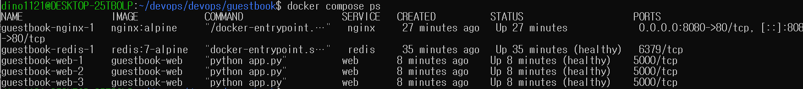
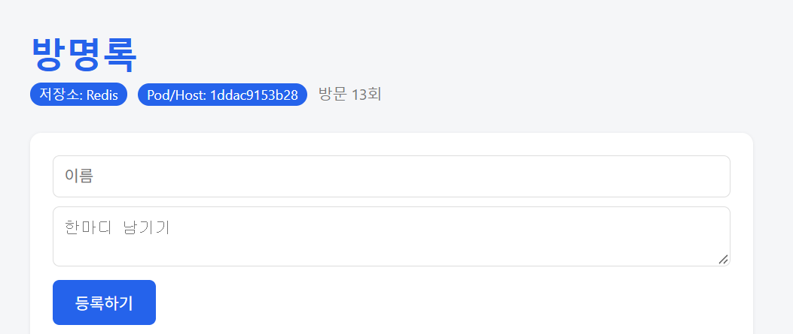
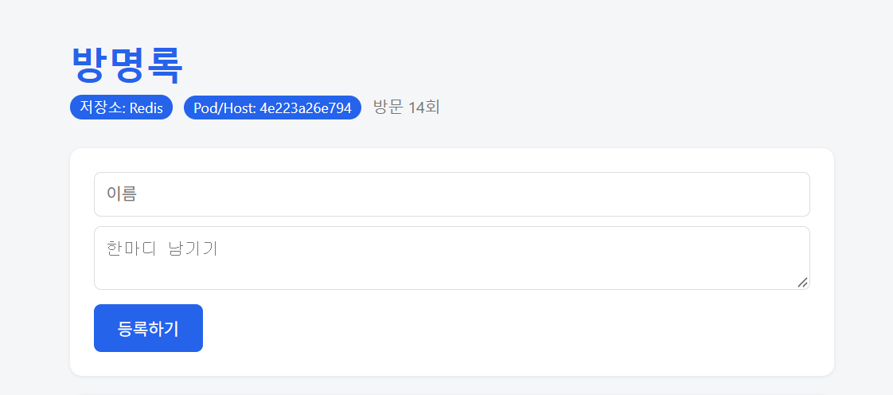
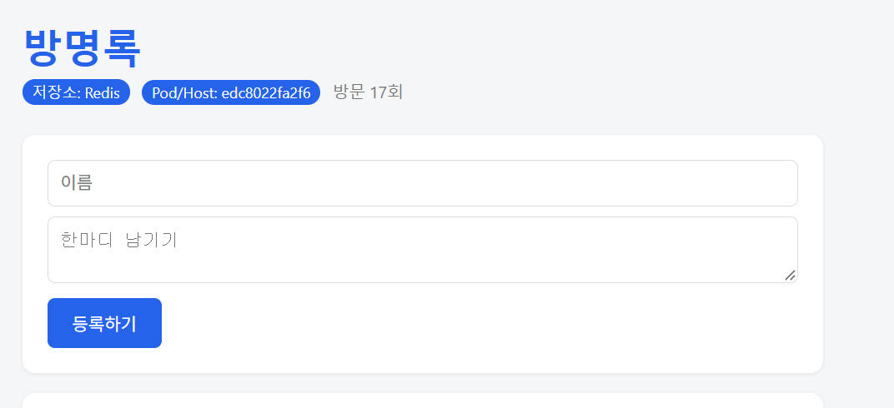
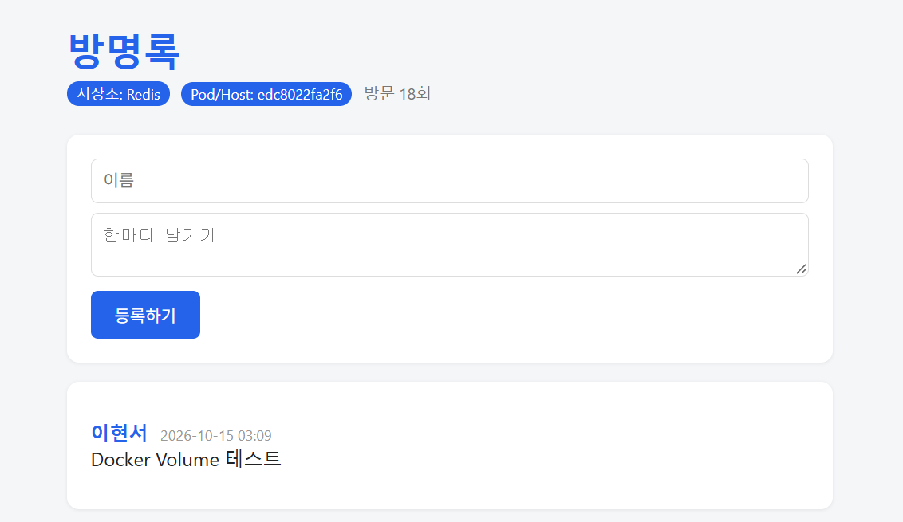
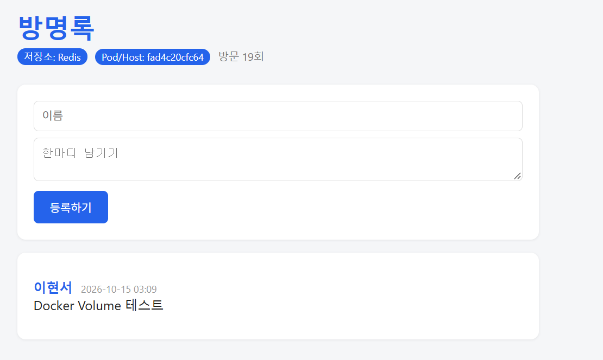
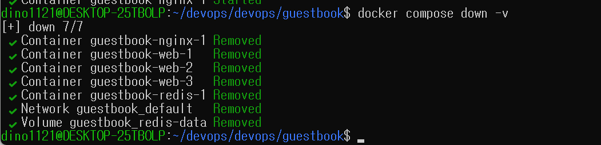
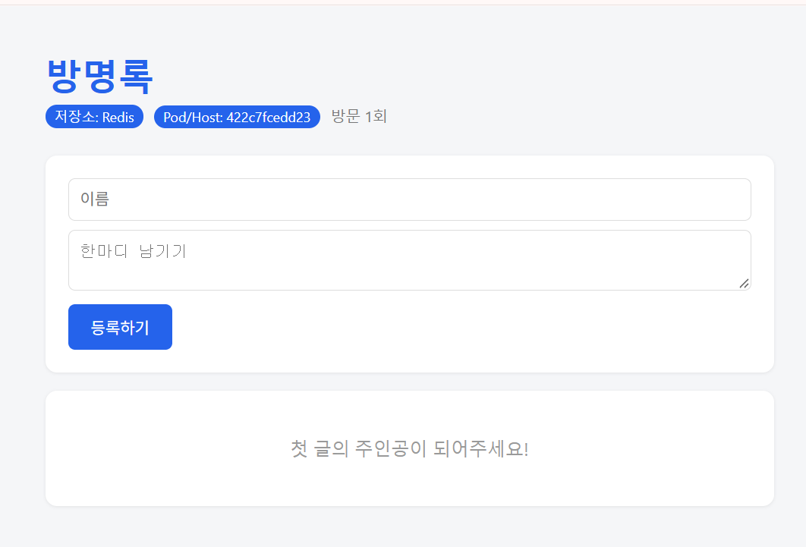

# Week 07 - Docker Compose 실습

## 1. Docker Compose를 이용한 서비스 구성

`compose.yaml`을 작성하여 Flask 기반 Guestbook 웹 애플리케이션과 Redis를 하나의 Compose 프로젝트로 관리하였다.

- `web`: Flask 방명록 애플리케이션
- `redis`: 방명록 데이터를 저장하는 Redis 서버
- `nginx`: 클라이언트 요청을 웹 컨테이너로 전달하는 리버스 프록시

`docker compose up -d`를 사용하면 정의된 여러 서비스를 한 번에 생성하고 실행할 수 있다.

```bash
docker compose config --quiet
docker compose up -d
```

`docker compose config --quiet`으로 설정 오류를 미리 검사할 수 있다.

---

## 2. 환경 변수 분리 (.env)

Redis 비밀번호를 `compose.yaml`에 직접 작성하지 않고 `.env` 파일로 분리하였다.

```dotenv
# .env.example
REDIS_PASSWORD=비밀번호
```

`compose.yaml`에서는 `${REDIS_PASSWORD:?비밀번호 설정 필요}` 형식으로 필수 값을 참조하였다. 값이 없으면 Compose가 오류를 표시하므로 잘못된 설정으로 실행되는 것을 방지할 수 있다.

실제 비밀번호가 들어 있는 `.env`는 `.gitignore`에 등록하여 Git으로 추적하지 않도록 설정하고, 공유용 예시 파일인 `.env.example`만 저장소에 포함한다. 단, `.env`는 암호화 수단이 아니라 설정 분리 방식이다.

---

## 3. Healthcheck와 실행 순서

Redis와 Web 서비스에 Healthcheck를 추가하여 프로세스 실행 여부뿐 아니라 서비스가 요청을 처리할 준비가 되었는지 확인하도록 구성하였다.

- `redis`: `redis-cli ... ping`을 실행하여 Redis 응답 확인
- `web`: Python으로 `http://localhost:5000/readyz`에 요청하여 준비 상태 확인
- `interval: 5s`: 5초마다 검사
- `timeout: 3s`: 검사 제한 시간 3초
- `retries: 5`: 실패 5회 이후 `unhealthy` 판정

`depends_on`에 `condition: service_healthy`를 적용하여 Redis가 정상 상태가 된 뒤 Web 서비스를 시작하고, Web이 정상 상태가 된 뒤 nginx를 시작하도록 설정하였다.

```bash
docker compose ps
```

`redis` 및 `web` 컨테이너가 `healthy`로 표시되는 것을 확인하였다.



[Compose 상태 캡처 원본](images/week07_01_compose_ps.png)

---

## 4. nginx 리버스 프록시 구성

`nginx.conf`를 작성하여 외부에서 들어오는 요청을 Flask 웹 서비스에 전달하도록 설정하였다.

```nginx
server {
    listen 80;
    resolver 127.0.0.11 valid=5s;

    location / {
        set $backend http://web:5000;
        proxy_pass $backend;
    }
}
```

`compose.yaml`에서 nginx의 컨테이너 포트 80을 호스트의 8080 포트에 연결하고, 웹 서비스는 `ports` 대신 `expose: "5000"`을 사용하여 호스트에 포트를 직접 게시하지 않도록 구성하였다.

요청 경로는 다음과 같다.

`브라우저(localhost:8080) → nginx(80) → web(5000) → Redis(6379)`

`resolver 127.0.0.11`은 Docker의 내부 DNS를 사용하며, `valid=5s`는 DNS 응답 캐시 시간을 설정한다.

---

## 5. 웹 컨테이너 Scale-out 및 요청 분산

Compose의 `--scale` 옵션을 사용해 웹 컨테이너를 1개에서 3개로 확장하였다.

```bash
docker compose up -d --scale web=3
docker compose ps
```

실행 후 `guestbook-web-1`, `guestbook-web-2`, `guestbook-web-3`가 정상적으로 시작된 것을 확인하였다.

브라우저에서 `localhost:8080`을 새로고침할 때 화면의 `Pod/Host` 값이 서로 다른 컨테이너의 호스트명으로 바뀌는 것을 확인하였다. 이를 통해 nginx를 거친 요청이 복수의 Web 컨테이너로 전달됨을 확인하였다.

| 웹 컨테이너 확인 | 실행 화면 |
| --- | --- |
| 첫 번째 화면 |  |
| 두 번째 화면 |  |
| 세 번째 화면 |  |

세 웹 컨테이너는 동일한 Redis 저장소를 사용하므로, 어느 웹 컨테이너가 요청을 처리하더라도 같은 방명록 데이터를 조회할 수 있도록 구성하였다.

---

## 6. Docker Volume 데이터 유지 비교

Redis에 방명록 데이터를 저장한 뒤 `docker compose down`과 `docker compose down -v`의 차이를 확인하였다.

### 6-1. 데이터 저장

방명록에 테스트 글을 작성하여 Redis에 데이터를 저장하였다.



### 6-2. down 후 데이터 유지

```bash
docker compose down
docker compose up -d --scale web=3
```

`down`은 Compose 컨테이너와 네트워크를 제거하지만, 명명된 볼륨인 `redis-data`는 유지한다. 컨테이너를 다시 생성한 뒤에도 방명록 데이터가 남아 있음을 확인하였다.



### 6-3. down -v 후 데이터 삭제

```bash
docker compose down -v
docker compose up -d --scale web=3
```

`down -v`는 컨테이너와 네트워크뿐 아니라 Compose가 관리하는 명명된 볼륨도 제거한다. 다시 실행하면 빈 Redis 데이터 볼륨이 새로 생성되므로 이전 테스트 글이 사라진 것을 확인하였다.





| 명령 | 컨테이너 및 네트워크 | 명명된 Redis 볼륨 | 기존 방명록 데이터 |
| --- | --- | --- | --- |
| `docker compose down` | 제거 | 유지 | 유지 |
| `docker compose down -v` | 제거 | 제거 | 삭제 |

---

## 7. Docker Compose Watch

`compose.yaml`의 `web` 서비스에 `develop.watch`를 추가하여 코드가 수정되면 자동으로 이미지를 재빌드하고 컨테이너를 재생성하도록 설정하였다.

```yaml
develop:
  watch:
    - action: rebuild
      path: ./app.py
    - action: rebuild
      path: ./templates
```

실행 방법:

```bash
# 터미널 1: 웹 컨테이너 3개 실행
docker compose up -d --scale web=3

# 터미널 2: 변경 사항 감시
docker compose watch --no-up
```

`watch --no-up`은 실행 중인 Compose 프로젝트를 대상으로 파일 변경을 감시한다. `Ctrl + C`를 누르면 감시를 종료할 수 있다.

---

## 8. 정리

이번 실습을 통해 다음 내용을 확인하였다.

- `compose.yaml`로 nginx, Flask, Redis 등 여러 서비스를 함께 관리할 수 있다.
- `.env`와 `.env.example`을 분리하고 필수 환경 변수 검사를 설정할 수 있다.
- Healthcheck와 `depends_on: condition: service_healthy`로 서비스 준비 상태에 따른 시작 순서를 구성할 수 있다.
- nginx 리버스 프록시를 통해 외부 요청을 내부 웹 서비스에 전달할 수 있다.
- `--scale web=3`으로 웹 컨테이너를 확장하고, 서로 다른 `Pod/Host` 응답으로 요청 분산을 확인할 수 있다.
- `docker compose down`은 명명된 볼륨을 유지하지만 `down -v`는 볼륨까지 제거한다.
- `develop.watch`를 이용하면 코드 변경 시 재빌드를 자동화할 수 있다.

