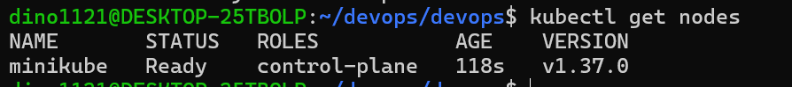
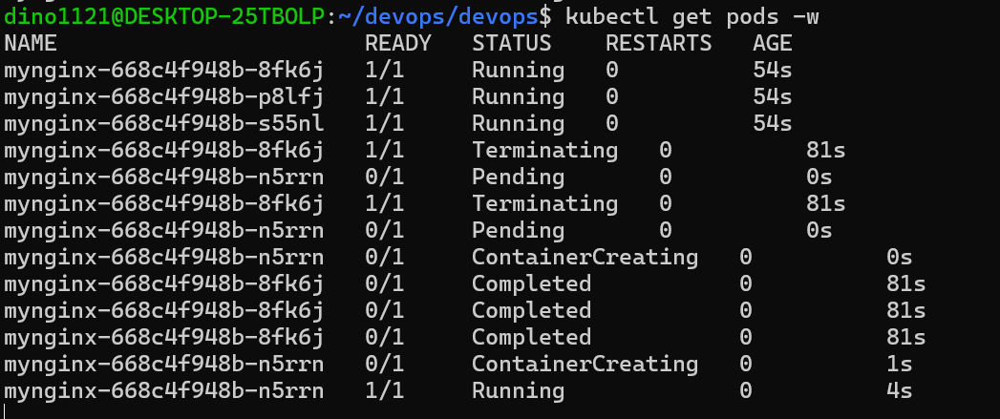
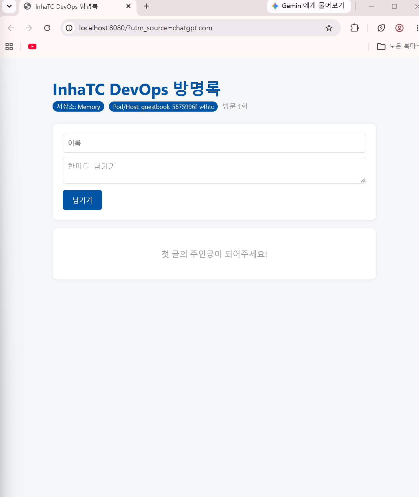

# Week 09 - Kubernetes 실습

## 1. 실습 환경

- Windows 11 / WSL2 Ubuntu
- Docker Desktop
- Kubernetes v1.37.0
- minikube
- kubectl

## 2. Kubernetes 클러스터 생성

Docker 드라이버를 사용하여 minikube 클러스터를 생성하였다.

실행 명령어:
- `minikube start --driver=docker`
- `kubectl get nodes`

노드 상태가 Ready인 것을 확인하였다.

## 3. Deployment 생성 및 자가 치유

nginx 이미지를 사용하여 Pod 3개를 생성하였다.

실행 명령어:
- `kubectl create deployment mynginx --image=nginx --replicas=3`
- `kubectl get pods`
- `kubectl get pods -w`

Pod 하나를 삭제했을 때 새로운 Pod가 자동으로 생성되는 것을 확인하였다.

## 4. 방명록 Kubernetes 배포

GHCR에 업로드한 방명록 이미지를 Kubernetes에 배포하였다.

실행 명령어:
- `kubectl create deployment guestbook --image=ghcr.io/dino1121/guestbook:v1`
- `kubectl get pods`
- `kubectl port-forward deployment/guestbook 8080:5000`

브라우저에서 localhost:8080으로 접속하여 정상 실행을 확인하였다.

Pod/Host 정보와 Memory 저장소가 표시되었다.

## 5. 선언형 관리

선언형 관리는 원하는 상태를 정의하고 시스템이 이를 지속적으로 유지하도록 하는 방식이다.

예를 들어 에어컨을 26도로 설정하면 현재 온도에 따라 자동으로 작동하는 것과 같다.

## 6. 실습 중 발생한 문제

- WSL E_UNEXPECTED 오류 발생 후 Windows 재부팅으로 해결
- Ubuntu에서 Docker 명령어를 찾지 못하는 문제 발생 후 WSL 연동 확인 및 복구

## 7. 실습 결과

Kubernetes 클러스터 생성과 Deployment의 자가 치유 기능을 확인하였다.

또한 GHCR에 업로드한 방명록 이미지를 Kubernetes에서 실행하고 브라우저 접속에 성공하였다.
