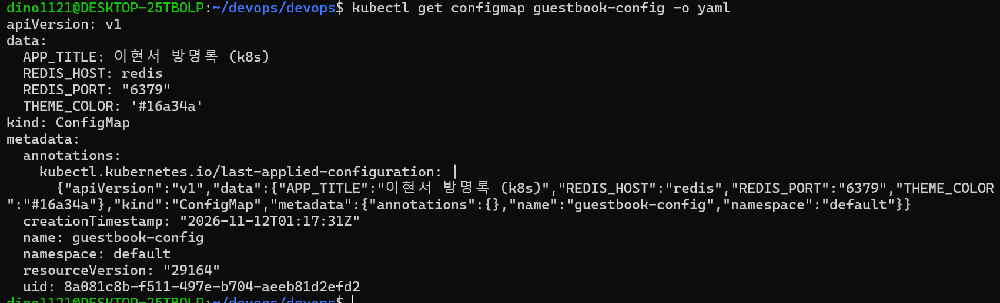
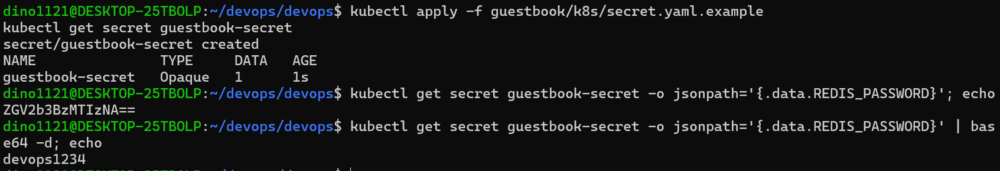
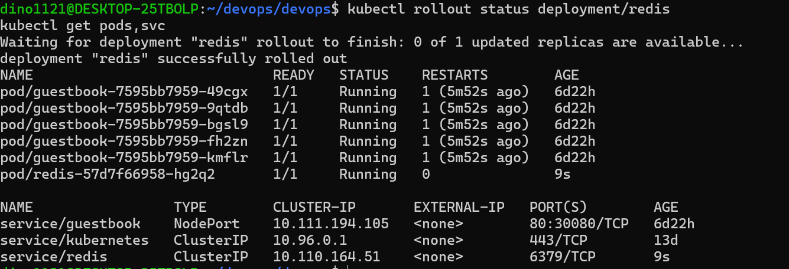
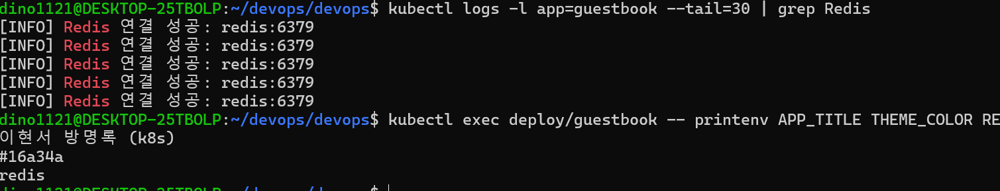
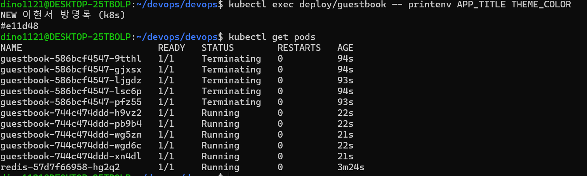
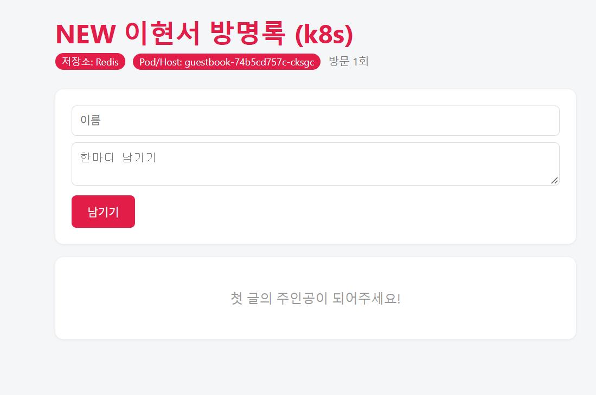
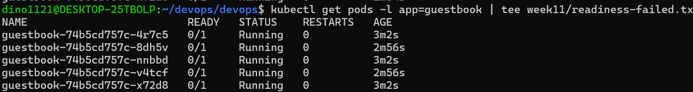
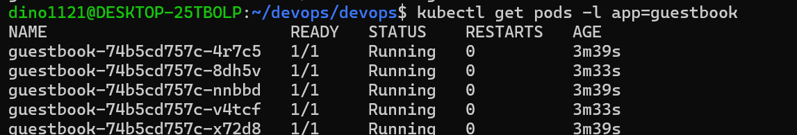
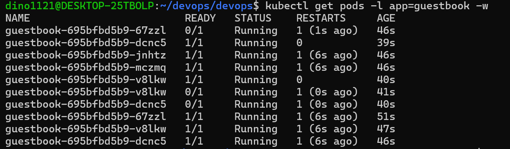
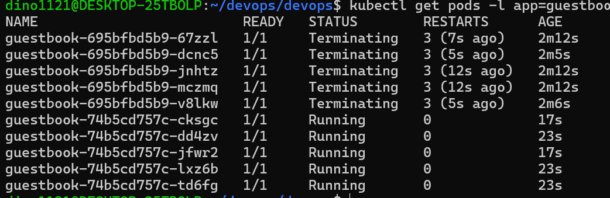

# Week 11 - Kubernetes 설정과 상태 점검

## 1. 실습 목표

Kubernetes의 ConfigMap과 Secret을 활용하여 애플리케이션 설정을 분리하고, Liveness/Readiness Probe를 통해 컨테이너 상태를 점검한다.

## 2. 실습 환경

- OS: Ubuntu (WSL2)
- Container Runtime: Docker Desktop
- Kubernetes: Minikube
- Application: Flask Guestbook
- Database: Redis
- Container Image: ghcr.io/dino1121/guestbook:v1

## 3. 실습 내용 및 결과

### 3.1 ConfigMap 생성

ConfigMap에 애플리케이션 제목, 테마 색상, Redis 접속 정보를 저장하였다.

- APP_TITLE: 이현서 방명록 (k8s)
- THEME_COLOR: #16a34a
- REDIS_HOST: redis
- REDIS_PORT: 6379

[설정 파일](../guestbook/k8s/configmap.yaml)

### 3.2 Secret 생성 및 Base64 디코딩

Kubernetes Secret을 생성하고 Base64 인코딩된 값을 디코딩하였다.

- Secret: guestbook-secret
- 인코딩값: ZGV2b3BzMTIzNA==
- 디코딩 결과: devops1234 (실습용 더미 비밀번호)

Base64는 암호화가 아니라 인코딩이므로 디코딩을 통해 원래 값을 복원할 수 있다.
따라서 실제 비밀번호를 GitHub에 공개하면 안 된다.

[Secret 예시 파일](../guestbook/k8s/secret.yaml.example)

### 3.3 Redis 배포 및 환경변수 주입

Redis Deployment와 ClusterIP Service를 생성하였다.

- Redis Pod: 1/1 Running
- Redis Port: 6379
- Guestbook Pod: 5개
- Redis 연결 성공: redis:6379

ConfigMap과 Secret을 envFrom으로 주입하여 Redis 연결을 확인하였다.

[Redis 설정](../guestbook/k8s/redis.yaml)
[Guestbook Deployment](../guestbook/k8s/deployment.yaml)

### 3.4 ConfigMap 설정 변경

컨테이너 이미지를 다시 빌드하지 않고 ConfigMap 설정을 변경하였다.

- APP_TITLE: NEW 이현서 방명록 (k8s)
- THEME_COLOR: #e11d48

ConfigMap 적용 후 Deployment를 재시작하여 변경된 환경변수를 확인하였다.

### 3.5 Readiness Probe 실패 및 복구

Redis Deployment의 replicas를 0으로 변경하여 연결 장애를 발생시켰다.

실험 결과:
- Guestbook Pod 5개 모두 READY 0/1
- STATUS: Running
- RESTARTS: 0

컨테이너는 실행 중이지만 요청을 받을 준비가 되지 않았으므로 Ready 상태가 false가 되었다.

Redis를 다시 실행하자 Guestbook Pod 5개가 모두 1/1 Running으로 복구되었다.

[실패 결과](readiness-failed.txt)

### 3.6 Liveness Probe 실패 및 복구

Liveness Probe의 검사 경로를 /healthz에서 존재하지 않는 /devops로 변경하였다.

실험 결과:
- 잘못된 경로로 인한 Liveness 검사 실패
- RESTARTS가 0에서 3까지 증가
- Kubernetes가 컨테이너를 반복 재시작

이후 검사 경로를 /healthz로 복구하였다.

최종적으로 새로운 Guestbook Pod 5개가 1/1 Running 상태로 복구되었다.

## 4. 트러블슈팅 3단 루틴

1. get: Pod의 READY, STATUS, RESTARTS를 확인한다.
2. describe: Pod의 상세 설정과 Events를 확인하여 오류 원인을 추적한다.
3. logs: 애플리케이션 로그를 확인한다. 컨테이너가 재시작했다면 --previous 옵션으로 이전 로그도 확인한다.

이번 실습에서는 Liveness 검사 경로를 잘못 지정하여 재시작이 발생하였다.
정상 경로로 복구한 후 /healthz와 /readyz의 HTTP 200 응답을 확인하였다.

[트러블슈팅 실행 결과](troubleshooting.txt)

## 5. 최종 결과

| 실습 항목 | 결과 |
|---|---|
| ConfigMap 생성 | 성공 |
| Secret 생성 및 디코딩 | 성공 |
| Redis 배포 | 성공 |
| Guestbook Redis 연결 | 성공 |
| ConfigMap 설정 변경 | 성공 |
| Readiness 실패 및 복구 | 성공 |
| Liveness 실패 및 복구 | 성공 |
| 트러블슈팅 3단 루틴 | 실행 기록 저장 |

## 6. 정리

- ConfigMap과 Secret을 사용하면 이미지와 설정을 분리할 수 있다.
- Secret의 Base64 인코딩 자체는 암호화가 아니다.
- Readiness Probe 실패 시 서비스의 요청 전달 대상에서 제외된다.
- Liveness Probe 실패 시 컨테이너가 재시작된다.
- Kubernetes 장애 분석은 get → describe → logs 순서로 진행한다.
