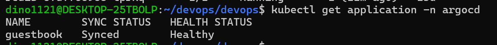
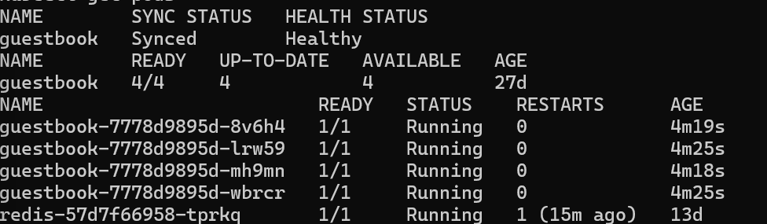
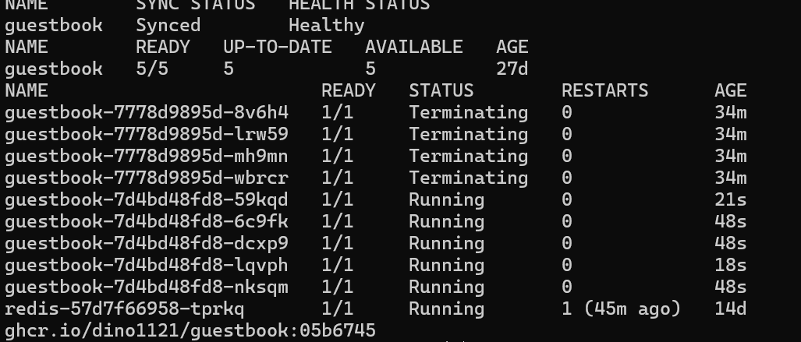
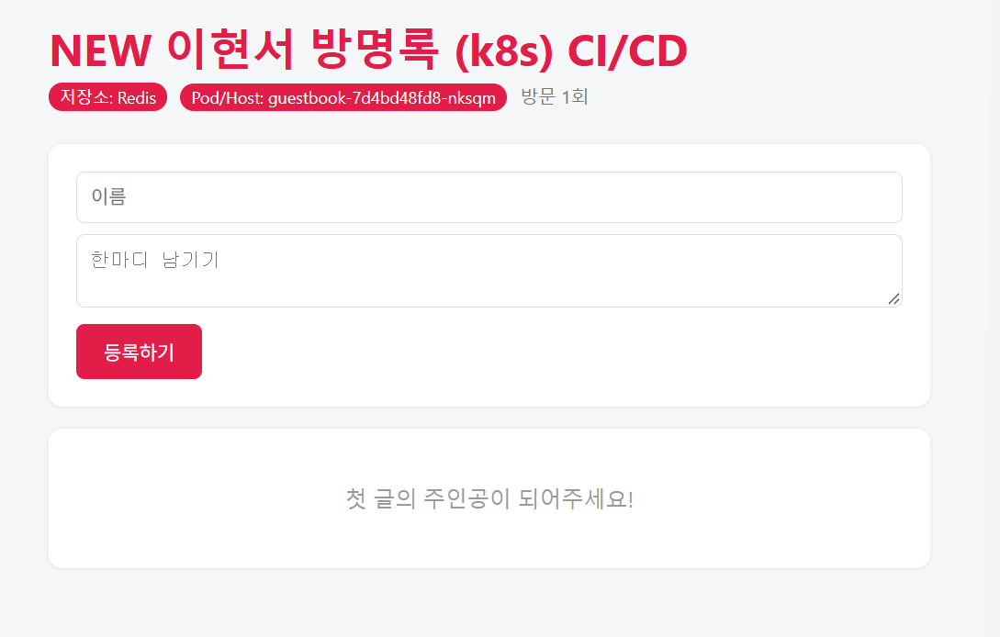

# 13주차 - GitOps

## 1. Argo CD 설치 및 Application 등록

Argo CD를 설치하고 GitHub 저장소의 Kubernetes 설정과 클러스터를 동기화하였다.

## 2. Git 변경을 통한 자동 배포

deployment.yaml의 replicas를 5에서 4로 변경하고 PR을 생성하여 main 브랜치에 머지하였다.

## 3. SelfHeal

클러스터의 replicas를 직접 변경하고 Git에 선언된 상태로 복구되는 과정을 확인하는 실습이다.

## 4. Git Revert를 통한 롤백

git revert를 이용하여 replicas를 기존 5개로 복구하였다.

## 5. ConfigMap 추가 및 Prune

Git에 ConfigMap을 추가하고 Argo CD를 통한 자동 생성을 확인하였다.

Git에서 ConfigMap을 삭제하여 클러스터에서도 자동으로 삭제되는 것을 확인하였다.

## 6. CI/CD 자동 배포

방명록 제목을 변경하고 GitHub Actions를 통해 새로운 컨테이너 이미지를 빌드하였다.

- 이미지 태그: 05b6745
- 배포 방식: Argo CD
- 업데이트 방식: Rolling Update

## 7. 최종 실행 결과

